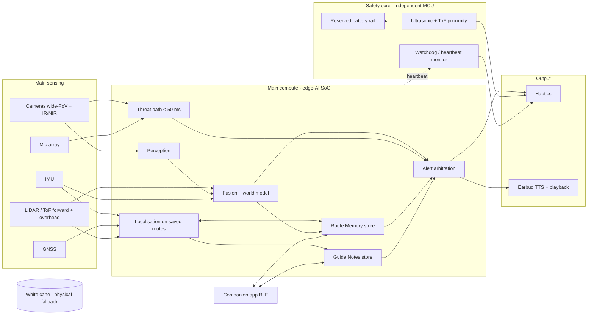

# L.I.G.H.T — Technical Requirements Document (TRD)

> **Status:** DRAFT v0.6 (form factor: one baton with a cane clip, replacing the grip sleeve plus sensor unit; founder decisions of 11-01 applied) · **Last updated:** 2026-11-01
> **Changed in v0.6:** §1, TRD-HW-002/005/006/012/014, §7, §9, §11. See PRD §0.1.
> Supersedes: TRD v0.4 (2026-09-01) in [`../docs/03_trd.md`](../../docs/03_trd.md) (outside this repo)
> Companion document: [PRD](01_prd.md)
> Tags: **[OPEN]** = undecided · **[ASSUMPTION]** = inferred · **[REC]** = engineering recommendation, pending decision · **[PROTO]** = early-prototype choice · **[PROD]** = production direction · **[DECIDED 10-31]** / **[DECIDED 11-01]** = confirmed by founder on that date
> Hardware IDs TRD-HW-001…013 are kept stable. New hardware starts at TRD-HW-014. New subsystems use TRD-REL (reliability), TRD-GN (Guide Notes) and TRD-MEM (Route Memory). Named parts are **illustrative**, not selected.

## 1. System overview & architecture

L.I.G.H.T is an **offline-first, real-time embedded system in two independent halves** **[DECIDED 10-31: principle]**:

1. **Main system:** sensors, an edge-AI processor, perception, sensor fusion, alert arbitration, Guide Notes and Route Memory.
2. **Safety core:** a small, separate microcontroller with its own proximity sensors, its own power reserve and its own path to the haptics. It runs **all the time**, checks that the main system is alive, and takes over basic obstacle warning if the main system fails.

The physical cane sits below both as the last fallback (PRD §6.2). **Both halves live in one baton** (about 20 cm × 38 mm, the original L.I.G.H.T form) **[DECIDED 11-01]**: a sensor head at the front, the body with buttons, and an ergonomic grip holding the haptic ring. On a cane, a **clip on the baton body** holds it on top of the shaft, parallel to it, sensor head toward the tip; the hand holds the baton grip with the cane's grip nested beneath it. There is no cable between parts. The unit treats ground level as covered by the cane tip; standalone, ground-level sensing becomes mandatory.

## 2. Hardware components

| ID | Component | Decision / recommendation |
|---|---|---|
| **TRD-HW-001** | **Main compute** (changed v0.5) | Edge-AI SoC with an NPU. **(v0.6)** It must fit and cool inside a 38 mm baton (§9); **volume, power and heat are the limits**. The v0.5 note that the 750–800 g budget put Jetson Orin Nano-class modules back in range no longer holds. Candidates: Jetson Orin Nano-class, Qualcomm QCS-class, Rockchip RK3588S-class, or a host plus a Hailo-class NPU. **[OPEN]** Phone offload for object ID is now an option, not a need (§11). |
| **TRD-HW-002** | **LIDAR / ToF ranging** (changed v0.5) | **Cane mode:** forward and overhead priority. **[REC]** 2–4 solid-state multi-zone ToF modules (forward, forward-up, left, right). **Standalone:** add a ground-facing module for drop-offs and kerbs. No spinning parts on a cane that gets knocked. **(v0.6)** The modules sit in the baton's sensor head, behind the ring of windows. On a cane the head points along the shaft, forward and down at the cane's angle (often 30–40° below horizontal), so the windows must be angled to keep forward and overhead covered in that position **[OPEN: head layout]**. |
| **TRD-HW-003** | **Cameras** | **[REC]** 1–2 wide-FoV, IR-capable cameras facing forward, ≥ 30 fps. Full 360° camera coverage moves to **[Secondary]** for cane mode, since the user's body blocks the rear. |
| **TRD-HW-004** | **Microphone array** | Acoustic threat cues with direction-of-arrival. **Also records Guide Notes** (TRD-GN-001); beamforming toward the speaker improves note quality. |
| **TRD-HW-005** | **Haptic grip** (changed v0.6) | **[DECIDED 11-01]** the haptic ring sits **inside the baton's ergonomic grip**, which the hand holds in both modes (replaces the 10-31 grip sleeve). A full ring of LRA-class actuators, so 360° directional feedback works as designed; **[REC]** 8–16 actuators around the circumference. Grip shell: soft-touch elastomer, contoured (slight hourglass waist, slightly oval cross-section) **[ASSUMPTION]**, with a channel on its underside for the cane's grip in cane mode. The baton's IMU tracks its roll in the hand, so each direction maps to the right actuator as the user rolls the cane. The safety core drives the haptic driver directly over an internal line, with no external link. **[OPEN]** how well vibration reaches the palm with the cane's grip nested beneath. |
| **TRD-HW-006** | **IMU (accel + gyro + mag)** | **Essential, more so than in v0.4.** One in the baton **(changed v0.6; the sleeve's second IMU is no longer needed)**. On a cane the baton swings with every sweep and rolls in the hand; the IMU stabilises the world model and the haptic direction to the user's **walking heading**, and drive step-based dead reckoning for Route Memory (TRD-MEM-002). |
| **TRD-HW-007** | **GNSS** | GPS/Galileo. Coarse position for Route Memory and navigation. Not enough alone for obstacle-level memory (TRD-MEM-002). |
| **TRD-HW-008** | **In-ear module** | Single wireless earbud, one ear open. Plays TTS, alerts, Guide Notes and route replay. |
| **TRD-HW-009** | **Battery + wireless charging** (changed v0.5) | Main battery plus a **reserved partition** for the safety core (TRD-HW-017). **[ASSUMPTION]** ≥ 1 full day of full features; **[REC]** aim for 2–3 days if the baton's volume allows (§9). Much longer for the safety core alone. Wireless charging dock retained. |
| **TRD-HW-010** | **Connectivity** | BLE to earbud and phone. Every core function, **including Guide Notes and Route Memory**, works offline. |
| **TRD-HW-011** | **Enclosure** (changed v0.5) | IP-rated (**[REC]** IP54 minimum, **[OPEN]**); built for cane knocks, vibration and drops (PRD-NF-010). |
| **TRD-HW-012** | **Physical controls** (changed v0.5) | Braille-labelled buttons: **Identify**, **Replay**, **Record** (press-and-hold, with a guard against accidental presses), **Status** ("what's working?"). **[OPEN]** final count and layout. **(v0.6)** On the baton body, ahead of the grip, under the thumb. The original baton has two pill buttons; mapping four functions onto them (or adding buttons) is **[OPEN]**. |
| **TRD-HW-013** | **Night-vision path** | NIR illuminator + IR-capable cameras. The safety core's ultrasonic sensors do not depend on light. |
| **TRD-HW-014** | **Cane clip and mode detection** (changed v0.6) | **[DECIDED 11-01]** a mechanical clip on the baton body attaches it to the cane. **[REC]** a tool-free sprung C-jaw on the underside of the body, just ahead of the grip, with a flush release lever and swappable elastomer inserts for shaft sizes **[ASSUMPTION: range to be measured]**. It grips the shaft just ahead of the cane's grip; the cane's grip nests in the channel under the baton grip (TRD-HW-005), which also stops the baton twisting around the shaft. A sensor in the jaw (**[REC]** a Hall sensor plus a magnet in the insert) detects **cane mode vs. standalone** (PRD-F-018/019). Unclipped, the baton is the standalone handheld as-is. **[OPEN]** support for crook and thick cork grips; quick release before folding a folding cane (PRD-F-017). |
| **TRD-HW-015** | **Safety-core MCU** (new) | Low-power microcontroller (**illustrative:** Cortex-M4/M33 class), physically separate from the main SoC. Own firmware, own clock, hardware watchdog. Direct line to the haptic driver, so it can vibrate the actuators even if the main SoC is dead. |
| **TRD-HW-016** | **Safety-core sensors** (new) | **[REC]** 1–2 ultrasonic sensors (work in darkness and sunlight, and detect glass) plus 1 single-zone ToF (overhead). Wired only to the safety core. Forward and overhead coverage. |
| **TRD-HW-017** | **Power partition** (new) | A separate regulator and power path from the battery to the safety core. When the battery reaches the reserve threshold, the main system is shut down first (PRD-F-024). **[REC]** reserve sized for **≥ 4 hours** of safety-core-only operation. **[ASSUMPTION]** |
| **TRD-HW-018** | **On-device storage** (new) | Encrypted flash (**[REC]** 16–32 GB eMMC/UFS) for Guide Notes, route data, and models. Encryption key held in a secure element or the SoC's secure enclave. |

## 3. Sensing & perception

- **[PROD/REC]** quantized on-device detectors (YOLO-class) on the NPU. The POC's web pipeline (TRD-CV-001…005: YOLOv8n, Depth Anything V2 Small, tracking, tiered fallback to COCO-SSD) carries forward as the reference behaviour.
- **Threat classification** is fused from cameras, microphones and ranging motion.
- **Cane-mode compensation:** perception runs on IMU-stabilised frames; detections are placed in a heading-stable frame, so a sweeping cane does not make obstacles appear to jump left and right.
- **Priority classes:** vehicles, people, cyclists, poles/bollards, walls, doors, overhanging branches and signs, stairs, kerbs/drop-offs, animals. In cane mode, ground classes are a backup to the cane; in standalone mode they are required.
- **Fixed vs. temporary classification** (new) — every tracked obstacle is labelled **fixed** (pole, bollard, step, wall, bench, branch) or **temporary** (person, vehicle, animal, bin, parked bike). Only fixed obstacles may be stored in Route Memory (TRD-MEM-004).

## 4. Reliability architecture

### 4.1 Principles **[DECIDED 10-31]**
- **No single failure removes basic obstacle warning.** The safety core shares no processor, firmware, sensor or power regulator with the main system.
- **No silent failure.** Every loss of a function is announced.
- **Fail toward caution.** When unsure, warn. Memory and models may add warnings but may never suppress a live sensor warning.

### 4.2 Requirements

| ID | Requirement |
|---|---|
| **TRD-REL-001** | **Heartbeat.** The main SoC sends a heartbeat to the safety core **[REC]** every 50 ms over a dedicated line. Missing **[REC]** 300 ms of heartbeats triggers safety-core takeover (L1). |
| **TRD-REL-002** | **Always-on cross-check.** The safety core runs its proximity sensing at every level, not only after a failure. Persistent disagreement with the main system's world model (e.g. safety core sees a close obstacle the main system does not) raises a warning and is logged. |
| **TRD-REL-003** | **Health monitor.** The main system tracks the health of each subsystem (each camera, each ToF, IMU, GNSS, NPU, earbud link, temperature, battery) and steps down the fallback ladder (PRD §6.2) when a dependency fails. |
| **TRD-REL-004** | **Announcement time.** Any step down the ladder is announced by haptics within **[REC]** 500 ms, and by voice when the earbud is connected. |
| **TRD-REL-005** | **Earbud loss.** If the earbud disconnects, haptics continue and a distinct pattern tells the user that audio is lost. Threat "STOP" falls back to the haptic pattern alone. |
| **TRD-REL-006** | **Power-on self-test** of every sensor, actuator and the safety core; result reported by sound and haptics (PRD-F-023). |
| **TRD-REL-007** | **Thermal and battery step-down.** Smart features shed in a fixed order: navigation → object ID → camera threat classification → main system off; the safety core keeps running. |
| **TRD-REL-008** | **Fault log.** A local, privacy-safe log of level changes and disagreements (no images, no audio), exportable for support only with user consent. |
| **TRD-REL-009** | **Mode-aware fallback.** In standalone mode there is no cane below L1; L1 entry is announced with a stronger, repeated pattern **[REC]**. |

### 4.3 Fallback ladder, technical view

| Level | Running | Trigger to enter |
|---|---|---|
| L4 Full | Main system complete + safety core | Normal |
| L3 Reduced smart | Ranging, cameras, threat path; object ID and navigation off | Battery or thermal threshold; NPU overload; GNSS loss (navigation only) |
| L2 Memory + geometry | Ranging + Route Memory (localised by GNSS + IMU + ToF scan match); camera threat classification off | Camera or perception failure; night with NIR failure |
| L1 Safety core | Safety-core sensors → haptics only | Heartbeat lost; main battery at reserve; main SoC fault |
| L0 Cane | Nothing electronic | Reserve exhausted (final pattern first) |

## 5. Guide Notes (assistor-recorded instructions)

| ID | Requirement |
|---|---|
| **TRD-GN-001** | **Capture.** Press-and-hold **Record** on the device records from the mic array with beamforming. Release stops. **[REC]** max 2 min per note; record start/stop earcons. |
| **TRD-GN-002** | **App capture.** The companion app can record on the phone and transfer the note to the device over BLE. The note is stored and played from the device, not the phone. |
| **TRD-GN-003** | **Encoding.** Opus, **[REC]** ~24 kbps mono (≈ 11 MB per hour of notes). |
| **TRD-GN-004** | **Tagging.** Each note stores: ID, timestamp, GNSS fix, saved-route ID and position along the route (if on a saved route or teach session), duration, optional name. No surrounding audio beyond the note itself. |
| **TRD-GN-005** | **Place trigger.** When the localiser (TRD-MEM-002) places the user within **[REC]** 5 m along-route of a note's position on the same route, or within **[REC]** 10 m by GNSS off-route, the note is queued for playback once per pass. |
| **TRD-GN-006** | **Playback arbitration.** Notes are lower priority than threats and system-health notices; their priority relative to navigation and object ID is user-configurable (PRD-F-007). A threat pauses playback; playback resumes from the start of the sentence after. |
| **TRD-GN-007** | **Storage and privacy.** Encrypted at rest (TRD-HW-018). Never uploaded by default. Deletion removes the audio file and its index entry. |
| **TRD-GN-008** | **Transcription (Later).** On-device speech-to-text for search and an in-app text view. |

## 6. Route Memory (learned paths, remembered obstacles)

| ID | Requirement |
|---|---|
| **TRD-MEM-001** | **Route model.** A saved route is an ordered chain of **waypoints** (every **[REC]** 2–5 m), each holding a GNSS fix, heading, distance along route, and a compact **place signature** (geometric features from ToF/LIDAR plus compact visual descriptors). **No raw images or video are stored.** |
| **TRD-MEM-002** | **Localisation on a route.** Fuse GNSS, IMU step-based dead reckoning, and matching against place signatures to estimate position along the route. **[ASSUMPTION]** target ±2 m along-route on saved routes. Must still work, less precisely, with cameras off (L2) using GNSS + IMU + ToF only; warning zones widen when precision drops. |
| **TRD-MEM-003** | **Teach session.** Start → walk → stop → name (by voice or app). Guide Notes recorded during the session attach to their waypoint. The route is saved only after confirmation. |
| **TRD-MEM-004** | **Obstacle memory.** Each remembered obstacle stores: route ID, distance along route, side offset, height band (ground / body / head), class, confidence, first seen, last seen, times seen. **Only "fixed" classes** (§3). |
| **TRD-MEM-005** | **Confidence update.** Each pass where the obstacle is seen raises confidence; each pass where its spot is clearly observed and it is absent lowers it. Below a threshold it is removed. New fixed obstacles seen on **[REC]** 2 passes are added. |
| **TRD-MEM-006** | **Early warning.** Approaching a remembered obstacle triggers a haptic cue earlier than live sensing would, with a **distinct "from memory" texture**, plus an optional spoken label. |
| **TRD-MEM-007** | **Live sensing always wins.** Memory may add a warning; it may never cancel, delay, or weaken a live sensor or safety-core warning (PRD-F-036). |
| **TRD-MEM-008** | **Replay and rehearsal.** A saved route plays back as an ordered event stream (start, turns, distances, remembered obstacles, Guide Notes, arrival) on the earbud and haptics. Step-by-step or continuous, with adjustable speed. Works with no network. |
| **TRD-MEM-009** | **Automatic route learning (v1, [DECIDED 10-31]).** Keep coarse GNSS + step traces of recent trips on-device; when a journey repeats **[REC]** 3 times with matching start, end and path, **ask** the user to save and name it. Coarse traces older than **[REC]** 30 days are deleted if not saved. Never saves without confirmation. |
| **TRD-MEM-010** | **Privacy.** Encrypted at rest; per-route and full wipe; no upload by default. Optional encrypted backup to the user's phone or cloud only by explicit opt-in **[OPEN]**. |
| **TRD-MEM-011** | **Capacity.** **[ASSUMPTION]** ≥ 50 routes of ≤ 5 km each; place signatures sized so all routes fit in **[REC]** < 2 GB. |

## 7. Feedback & arbitration

- **Haptic encoding:** position on the grip's actuator ring = direction (heading-stabilised and corrected for the baton's roll in the hand), intensity = proximity, top 3 at once. Threat = heavy whole-unit pattern. **New textures** **[REC]**: "from memory" (softer, double pulse), "reduced mode", "basic mode (safety core)", "audio lost", "recording". All must be distinguishable by touch alone; validate with users.
- **Arbitration order [DECIDED 10-31: top two fixed]:** (1) threat, (2) system-health notices, then user-configurable order between navigation, object ID, Guide Notes, and Route Memory labels. The safety core's haptics can always break through.

## 8. Connectivity, companion app & cloud

- BLE to the phone and the earbud. No function in the PRD's v1 scope needs the internet.
- **Companion app (v1):** pair; settings; list, play, rename, re-record, delete Guide Notes; list, rename, delete, replay routes; record notes on the phone (TRD-GN-002); health report.
- **Cloud:** none in v1 by default. Progressive-loss analytics stays opt-in and moves to [Later]. Backup of notes and routes is **[OPEN]**.

## 9. Power, thermal & form factor

- **Central tension (changed v0.6):** now **volume**, power and heat. Sensors + NPU + cameras + NIR + safety core + 1–3 days of battery must fit a sealed baton of about 20 cm × 38 mm (about 230 cm³), held in the hand. **[REC]** treat the power and volume budget as the first engineering task, and test wrist fatigue and the combined grip with a weighted mock-up early.
- **Weight [OPEN]:** the 10-31 budget of 750–800 g (PRD-NF-004) assumed the larger two-part form and cannot fit in about 230 cm³, since that would be denser than solid aluminium. A realistic weight for the baton is closer to the earlier 350–450 g target **[ASSUMPTION]**. Resolve together with the compute choice (TRD-HW-001): Jetson Orin Nano-class modules are unlikely to fit or cool in a 38 mm tube; RK3588S-class or a host plus a Hailo-class NPU are more realistic **[REC]**.
- The safety core plus its sensors should draw **[REC]** < 100 mW.
- Thermal: continuous inference in a sealed unit held near the hand. Surface temperature limit for skin contact applies. **[OPEN]**
- Weight sits at the hand, which keeps cane balance; the battery sits in the body nearest the grip **[REC]**. The clip position is fixed by the cane's grip, which nests under the baton grip. **[OPEN]**

## 10. Data, privacy & safety

- **On-device by default** for camera, microphone, Guide Notes and Route Memory. Raw camera and microphone streams never leave the device (TRD-CV-004).
- **Guide Notes** contain the assistor's voice: deliberate start only, audible recording cue, on-device storage, deletable. **[OPEN]** legal review on recording third parties in public across EU member states.
- **Route Memory** is location history: encrypted, deletable, no upload by default. Treat as sensitive personal data.
- **Opt-in cloud analytics (Later):** GDPR Art. 9 explicit consent for health-adjacent data, DPA with provider, encryption in transit and at rest, EU data residency **[REC]**.
- **Safety:** fallback ladder (§4), no silent failure, memory never suppresses live warnings, cane as physical fallback.
- **Regulatory [OPEN]:** whether the product is a general accessibility device or a medical device under EU MDR affects testing and claims. Getting advice is a v1 task.

## 11. Open technical questions & assumptions

**New in v0.6**
- **Weight vs. volume:** the 750–800 g budget does not fit the baton (§9, PRD-NF-004).
- **Compute in a 38 mm tube:** module size and heat (TRD-HW-001, §9).
- **Combined grip:** comfort, thickness and vibration transfer with the cane's grip nested under the baton grip (TRD-HW-005).
- **Supported cane grips:** which grips nest in the channel; crook and thick cork grips (TRD-HW-014).
- **Sensor head layout** for forward and overhead coverage at the cane's angle (TRD-HW-002).
- **Button count** on the baton body (TRD-HW-012).

**New in v0.5**
- ~~**Grip sleeve fit and rotation tracking**~~ → the sleeve is gone (v0.6); roll tracking now uses the baton's IMU (TRD-HW-006).
- **Power and thermal budget** (TRD-HW-001/009, §9).
- **Phone offload** for object ID: less needed now, but could still save power. Safety functions must never depend on the phone. **[OPEN]**
- **Cane compatibility range** and clip design (TRD-HW-014).
- **Localisation accuracy** on saved routes without cameras (TRD-MEM-002).
- **Haptic texture vocabulary:** how many distinct patterns users can reliably tell apart (§7).
- **Safety-core sensor choice** and false-alarm rate on a sweeping cane (TRD-HW-016).
- **Backup** of notes and routes: none, phone-only, or opt-in cloud (TRD-MEM-010).

**Carried from v0.4**
- Compute for < 50 ms threat inference (TRD-HW-001).
- 360° night coverage and NIR power (TRD-HW-013).
- Point-to-identify aiming (PRD-F-004).
- Exact analytics data and GDPR lawful basis (Later).
